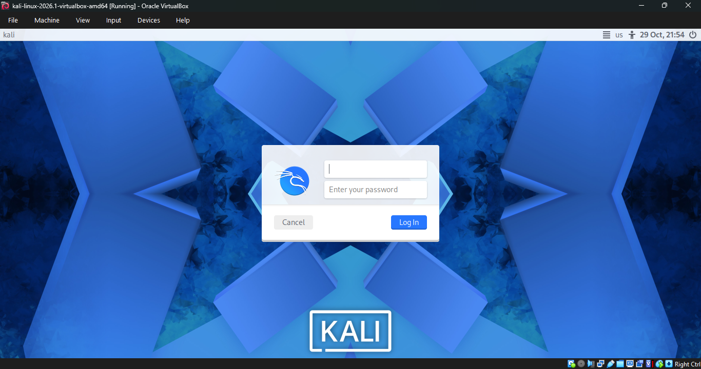
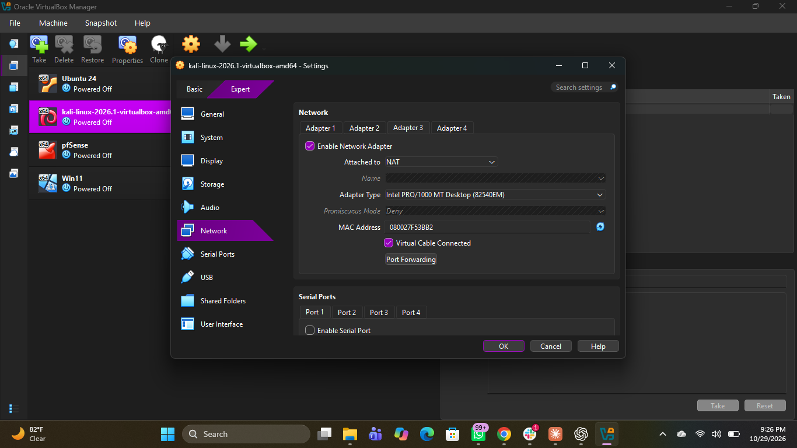
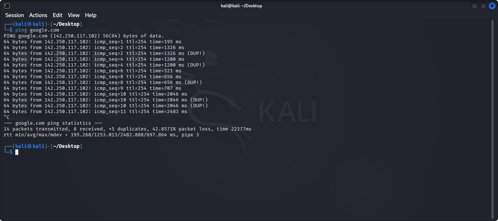

# Cybersecurity Lab Environment Setup

---

## Project Overview

This project is Week 1 of the Networkwalks Cybersecurity Internship. The objective was to set up a Kali Linux virtual machine in VirtualBox and configure its network connection for cybersecurity lab practice.

I deployed the virtual machine, configured the network adapter to use NAT, and tested connectivity by pinging Google. The test was successful, confirming that the virtual machine could reach the internet.

All activities were carried out in my own lab environment.

## Objectives

- Deploy a Kali Linux virtual machine in VirtualBox.
- Configure the network adapter to use NAT.
- Verify network connectivity.
- Prepare the lab environment for future cybersecurity practicals.

## Lab Environment

| Component | Details |
|---|---|
| Host operating system | Windows |
| Hypervisor | VirtualBox |
| Guest operating system | Kali Linux |
| Network adapter mode | NAT |

## Setup and Verification

### Step 1: Deploy Kali Linux

I deployed the Kali Linux virtual machine in VirtualBox and started it successfully.

### Step 2: Configure the Network Adapter

I configured the virtual machine's network adapter to use NAT, allowing the virtual machine to access the internet through the host's network connection.

### Step 3: Test Network Connectivity

After configuring the network adapter, I used the `ping` command to test connectivity to Google. The successful responses confirmed that the virtual machine had network connectivity.

## Troubleshooting

No major issues were encountered during the setup and connectivity test.

## What I Learned

- How to deploy and run a Kali Linux virtual machine in VirtualBox.
- How to configure a NAT network adapter.
- How to use the `ping` command to verify network connectivity.
- The importance of validating network access before beginning further cybersecurity lab activities.

## Legal and Ethical Notice

This lab was configured for educational purposes in my own virtual environment. Any future security testing will be limited to systems I own or have explicit permission to test.

## Author

**Utibe Anthony**

Networkwalks Cybersecurity Internship — Batch 084D
